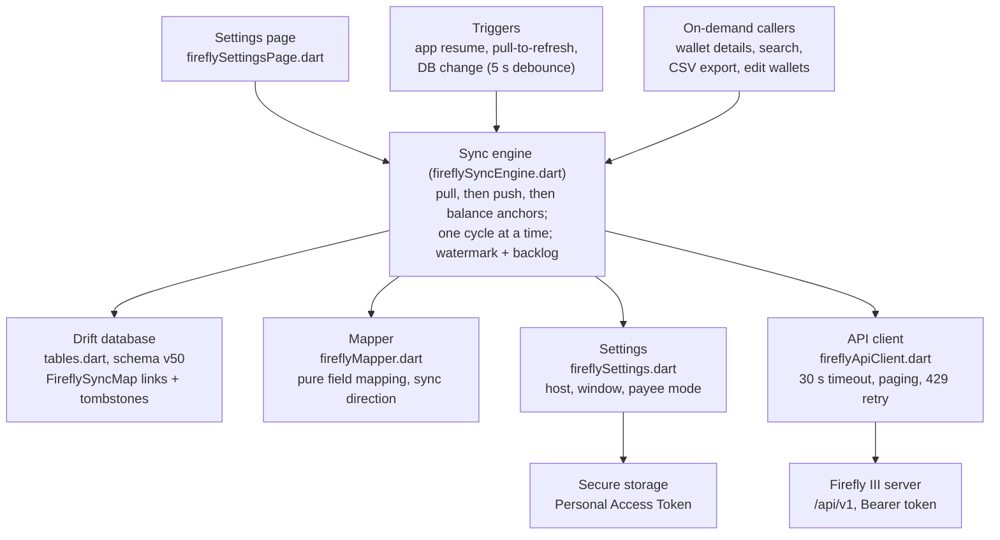

# Firefly III Sync for Cashew — Requirements & Specs

> This is the spec of the two-way sync engine of `feature/firefly-iii-sync`.
> Branch `feature/firefly-client` replaces that engine; see
> `FIREFLY_CLIENT_PLAN.md`.

As of 2026-10-13. Living version: https://claude.ai/code/artifact/4cdd4710-b47e-48d3-ad43-53f1c001828e

## Overview

The branch `feature/firefly-iii-sync` adds two-way sync between Cashew and a self-hosted Firefly III server. Phase 1 covers three entities: accounts (Cashew wallets ↔ Firefly asset accounts), transactions (withdrawal, deposit, transfer) and top-level categories. It authenticates with a Personal Access Token and resolves conflicts last-write-wins.

**Goals**

- Keep wallets, transactions and categories the same on both sides without manual export/import.
- Never lose or duplicate data on either side. Most of the work after the first commit serves this goal.
- Keep a sync cycle running when Firefly refuses one row.
- Work offline-first: Cashew stays the primary store; sync is polling (foreground, pull-to-refresh, debounced push).

**Non-goals for phase 1** (from `budget/FIREFLY_SYNC_FUTURE_SCOPE.md`)

| Area | Status | Reason |
| --- | --- | --- |
| Budgets | Deferred | Cashew budget windows do not map to Firefly budget + budget-limit |
| Objectives, goals, loans | Deferred | Would map to piggy banks and liability accounts |
| Tags | Deferred | Cashew has no local tag table |
| Bills, subscriptions, recurring | Deferred | Firefly models these as separate resources |
| Subcategories | Not synced | Firefly categories are flat; counted in the report, never pushed |
| Liability accounts | Not synced | Loan, debt, mortgage do not become wallets |
| OAuth2 | Deferred | Needs a redirect flow; PAT only |
| Webhooks / real-time | Deferred | A phone has no public endpoint |
| Conflict review UI | Deferred | Last-write-wins with no visibility |

## Current status

Phase 1 is built and hardened, but not merged: PR #6 is open, the branch is 20 commits ahead of `main` and pushed (HEAD `ab58f372`, 2026-09-11). Most commits after the first one fix data-loss or duplication faults found by two adversarial reviews and two divergences on the user's live server (`money.onku.dev`).

| Date | Commit | Change |
| --- | --- | --- |
| 2026-09-11 | `ab58f372` | Keep a cross-currency transfer's foreign amount; hold back pre-link history; stop creating one expense account per description |
| 2026-09-10 | `274b83e1` | Fake Firefly now enforces the real PUT, journal-delete and paging contracts; 107 tests pass |
| 2026-09-10 | `4cf16e21` | Hold back a push Firefly would book in another currency; recover a create whose answer was lost |
| 2026-09-10 | `5027975f` | 30 s request timeout; refuse a record that cannot be read |
| 2026-09-10 | `f653c816` | Never rewrite a Firefly row that belongs to another account |
| 2026-09-10 | `029ddff9` | Link follows the wallet when the primary wallet changes; never push into an inactive account |
| 2026-09-10 | `6a6e7cde` | One refused row no longer stops the cycle |
| 2026-09-09 | `0a0ba6e8` | Close the twelve findings of the first adversarial review |
| 2026-09-08 | `367105fe` | Identify splits by journal id, not array position |
| 2026-09-08 | `e46aef13` | Fix upgrades never reaching the Firefly migrations |
| 2026-09-08 | `4bc23b77` | Fix eight compile errors (first time the code compiled) |
| 2026-09-08 | `c69d573b` | Sync only a recent window of Firefly history |
| 2026-09-08 | `33373309` | Add two-way Firefly III sync |

The working notes live in three files: `budget/todo.md` (done and outstanding items, decisions), `budget/FIREFLY_SYNC_FINDINGS.md` (review findings and their fixes), and `budget/FIREFLY_SYNC_FUTURE_SCOPE.md` (deferred scope). Where todo.md and FINDINGS overlap, todo.md wins.

## Architecture

The sync is five new files under `budget/lib/struct/firefly/` plus a settings page, one new table and hooks in eleven existing files. All reads and writes go through `fireflySyncEngine.dart` (about 4,000 lines).

The mapper is pure and unit-tested; the engine owns all database and network side effects. Models live in `fireflyModels.dart`.

**Hooks in existing Cashew code:** `main.dart` (sync on resume), `navigationFramework.dart` (pull-to-refresh, DB-change push), `pullDownToRefreshSync.dart`, `settingsPage.dart` (entry), `accountAndBackup.dart` (Drive sync exclusion), `walletDetailsPage.dart`, `transactionsSearchPage.dart`, `exportCSV.dart` and `editWalletsPage.dart` (on-demand fetches), `navigationSidebar.dart` (last-synced time), `defaultPreferences.dart`.

**Database** (`tables.dart`, schema 50): table `FireflySyncMap` with `syncMapPk`, `entityType` (wallet, transaction, category), `localPk`, `fireflyId`, `fireflyUpdatedAt`, `lastSyncedLocalModified`, `isTombstone`, `counterpartyFireflyId`, `fireflySplitIndex`, `fireflyJournalId`, `dateCreated`. Unique on `(entityType, localPk)`, indexed on `(entityType, fireflyId)`. Migrations v47–v50 are hand-rolled in `onUpgrade` because the generated schemas stop at v46.

## Connection and settings

The user enters a host URL and a Personal Access Token on the Firefly settings page. The token is stored only in `flutter_secure_storage` (key `fireflyPersonalAccessToken`), so backups and Google Drive sync never carry it.

**Preferences** (`defaultPreferences.dart`, written with `updateGlobalState: false`)

| Key | Default | Meaning |
| --- | --- | --- |
| `fireflyEnabled` | `false` | Master switch |
| `fireflyHostUrl` | `""` | Server URL |
| `fireflyLastSyncedAt` | `""` | Push watermark (ISO string) |
| `fireflySyncWindowDays` | `30` | Pull window; clamped 7–3650, UI offers 7/14/30/60/90/180/365/730 |
| `fireflyCounterpartyNaming` | `"generic"` | Payee account: `generic` (instance cash account) or `category` |
| `fireflyLinkedAt` | none | Set on first sync; rows created before it count as pre-link history |

**Setup flow**

1. Enter the host. The client adds `https://` when no scheme is given and strips a trailing `/` and `/api/v1`. There is no other validation.
2. Enter the token (obscured field, cleared after save). "Test connection" calls `GET /about` and shows "Firefly III v{version}".
3. Turn sync on. If Google Drive `backupSync` is on, a dialog asks to turn it off; the two syncs are mutually exclusive.
4. The first `fireflySyncNow()` runs. Unlinked accounts and categories match local ones by case-insensitive name, or are created.

**Other settings-page actions:** "Push unsynced changes" (with a count), "Sync all history", "Upload local history", "Reset Firefly links", and "Linked accounts" (a picker per local wallet; warns about a taken account or a currency mismatch before linking). The main settings page shows "On – host" or "Off".

**Rules**

- Changing the host asks first, then clears the token, every link, the balance anchors, `fireflyLastSyncedAt` and `fireflyLinkedAt`. A token and an id are valid for one server only.
- A restore without a token switches sync off and explains that backups do not carry the token.
- Manual linking writes nothing to Firefly. The old account is tombstoned, the chosen account's links are cleared, then a sync runs.

## Data mapping

Each Cashew wallet maps to one Firefly asset account. Each transaction maps to one split (journal) of a Firefly transaction group, and each main category maps to one Firefly category. Links live in the `FireflySyncMap` table.

| Cashew | Firefly | Fields synced | Notes |
| --- | --- | --- | --- |
| Wallet | Asset account | name, currency, `account_role`, `active` | Push keeps the remote role (default `defaultAsset`) and active flag; pull merges name and currency only |
| Main category | Category | name | Pulled categories get `income: false`; subcategories never pushed (`skippedSubcategories`) |
| Transaction, amount > 0 | Deposit split | amount, date, description, notes, category, payee | Amount sent as `abs().toStringAsFixed(2)`; empty description → "(no description)" |
| Transaction, amount < 0 | Withdrawal split | same | Pulled rows are `paid: true`; a pull update keeps Cashew-only fields |
| Transfer pair (two rows, category `"0"`) | One transfer split | amount, `currency_code`, `foreign_amount`, `foreign_currency_code` | Source leg carries `external_id`; text comes from the leg edited last |
| Balance anchor row | Account `current_balance` | derived | Never pushed; excluded from CSV export |
| — | Expense, revenue, cash accounts | — | Loaded as payees only; never become wallets |
| — | Opening balance, reconciliation | — | Skipped on pull (already inside `current_balance`) |
| Budgets, tags, objectives | Budgets, tags, piggy banks | — | Not mapped |

**Identity**

- Each create and update sends the local primary key as `external_id`.
- Splits match by `transaction_journal_id`. Rows from builds before that column match by position only while `fireflyPositionMatchIsSafe` holds.
- A PUT names every split of the group; an untouched split goes as `{transaction_journal_id}` alone, because Firefly deletes any split the PUT omits.
- Reserved local categories: `"0"` (balance correction, transfers) and `"firefly-uncategorized"` (remote rows with no or unknown category; pushed back as no category).

**Payee (counterparty) account**, resolved in order:

1. The stored `counterpartyFireflyId`.
2. An expense or revenue account whose name equals the description.
3. An account whose name equals the category name.
4. Otherwise: `generic` mode uses the instance's cash account (or the name "Cash account"); `category` mode sends the category name.

**Currency**

- Firefly books a split in the asset account's currency, not the request's `currency_code`. A wallet whose currency differs from its account's is therefore held back.
- Only transfers carry a foreign amount. Withdrawals and deposits ignore `foreign_amount` on pull and never send it.
- On a cross-currency transfer push, the side that did not change locally keeps Firefly's amount (tolerance half a cent), and the local row is healed first.

**Balance anchor:** one hidden row per wallet (`firefly-balance-anchor-<walletPk>`), amount = Firefly `current_balance` minus the sum of the other paid local rows up to the end of today. It is dated one day before the earliest local row and rewritten only for a change of at least 0.005.

**Dates:** the push sends the local `dateCreated` with no offset; the pull parses with `DateTime.tryParse`; window parameters are date-only.

## Sync behavior

A cycle pulls first, pushes second, and refreshes balance anchors last. Only one cycle runs at a time; change detection uses timestamps, not hashes.

**Triggers** (there is no periodic timer)

- App resume (`main.dart`).
- Pull-to-refresh, also when Firefly is the only sync on.
- Any local database change → `scheduleFireflyPush`, debounced 5 s. The engine's own writes do not trigger it.
- Buttons on the settings page.

**Cycle order**

1. Ensure the reserved categories exist.
2. Pull: categories → asset accounts → payee accounts → transactions in the window → apply remote deletes.
3. Push: categories → accounts → transactions → deletes.
4. Refresh balance anchors (in push-only cycles, only when something was pushed).

**Modes**

| Mode | Pull | Push scope | Used by |
| --- | --- | --- | --- |
| Normal | Last N days (`fireflySyncWindowDays`) | Rows changed since the watermark | Triggers above |
| `fullResync` | All history, with `healUnchanged` | Same | "Sync all history" |
| `pushOnly` | None | Same | Follow-up after an edit during a cycle |
| `pushUnsynced` | None | Rows since `fireflyUnsyncedSince()` | "Push unsynced changes" |
| `pushExistingLocalHistory` | None | Everything since 2000, incl. rows with no modified time | "Upload local history" |
| On-demand fetch | A range, search or one account; no delete pass, watermark unchanged | None | Wallet details, search (≥ 3 chars), CSV export, edit wallets |

**Conflict rule:** `decideSyncDirection` compares local `dateTimeModified` with `lastSyncedLocalModified`, and remote `updated_at` with `fireflyUpdatedAt`. If both changed, the newer timestamp wins. Every push update reads the live record first, so a remote change after the last sync is seen.

**Watermark:** the next watermark is the cycle start time, or the oldest row that was not sent (`_FireflyPushBacklog`), so a held-back row is offered again next cycle.

**Push rules**

- Only rows with `paid == true` are sent; both legs of a transfer must be paid. A row that goes from paid to unpaid is removed from Firefly and its link deleted (no tombstone, so it can return).
- An unlinked row created before `fireflyLinkedAt` is not uploaded except through "Upload local history". The gate reads `dateCreated`, because `convertToPrimaryWallet` rewrites `dateTimeModified` on every row it moves.
- A per-row failure is caught, counted (`failed*`) and warned; the cycle goes on. Auth and rate-limit errors end the cycle.

**Deletes**

- Remote: a linked row inside the window that is missing from the answer is confirmed with `GET /transactions/{id}`; only a 404 deletes it locally. Removed splits of a surviving group are unlinked and deleted. A deleted category moves its rows to uncategorized. A deleted wallet goes only when it is empty and not `"0"`.
- Local: see the destructive-path rules under error handling. All deletes leave tombstones in `FireflySyncMap`.

**Primary wallet:** Cashew cannot delete pk `"0"`; `convertToPrimaryWallet` copies another wallet onto it. `swapFireflyWalletLinks` moves both links in the same transaction, so the link follows the wallet.

## Error handling and safety rules

The rule behind every item: when the app cannot prove a write is correct, it holds the row back, keeps the watermark at it, and warns once. It never guesses.

**Network and server errors**

| Condition | Behavior |
| --- | --- |
| Request never answers | Ends after `kFireflyRequestTimeout` (30 s) as a network error; the cycle ends and the engine lock is released |
| 429 with `Retry-After` ≤ 5 s | Waits once and retries; longer ends the cycle (Firefly has no rate limit; this is for a reverse proxy) |
| 422 on one row (e.g. duplicate account name) | That row fails; the cycle continues; a refused name links to the existing remote record |
| 404 on an update | Closes the link and keeps the local record |
| 401 for an unknown journal id | Firefly answers 401, not 404, so the app checks the id is in the live group before a delete |
| Record that cannot be read | Skipped with a warning; the cycle continues |
| Split with no type, date or amount | Refused, never filled with defaults |
| Missing token | Sync switches off and says a backup does not carry the token |

**Held-back pushes** (each counted in the sync report, warned once per account or per cycle)

| Counter | Cause |
| --- | --- |
| `skippedInactiveAccount` | Wallet linked to an inactive Firefly account |
| `skippedCurrencyMismatch` | Wallet currency differs from the Firefly account currency; Firefly would book it in the account's currency |
| `skippedMovedRemoteRow` | The mapped group belongs to an account no local wallet is linked to |
| `skippedPreLinkHistory` | Unmapped row with `dateCreated` before `fireflyLinkedAt`; upload with "Push local history" |
| `recoveredCreates` | Not a skip: a lost create found again by `external_id` and linked |

**Destructive paths that are blocked**

- A local wallet delete only unlinks (tombstone). `DELETE /accounts/{id}` on Firefly destroys every journal of that account and the full group of each.
- A local transaction delete removes only its own split (`DELETE /transaction-journals/{id}`), and the full group only when it has one split.
- A remote delete of an in-use asset account keeps the Cashew wallet and tombstones the link.
- A pair of transfer rows that point at two Firefly groups is not pushed; the user is told.
- "Reset Firefly links" is the only way to rebuild links. Turning sync off does not clear them, because the next pull would then import every transaction a second time.
- A change of host clears the token and every link, after asking.

## Testing

The suite had 107 passing tests at `274b83e1`; `ab58f372` added ten divergence tests. Engine tests run real HTTP against a fake Firefly on the loopback interface, with an in-memory Drift database.

| File | Covers |
| --- | --- |
| `test/firefly/firefly_test_env.dart` | `FakeFirefly`: accounts, categories, groups; real paging; 422 on duplicate names; date-window filter; PUT deletes unnamed splits and answers 401 for a foreign journal id; journal DELETE answers 404 for an unknown id |
| `firefly_mapper_test.dart` | Pure mapping: round-trips, split types, signs, transfers and foreign amounts, role/active, payee order, `decideSyncDirection`, journal-id matching, `fireflyPositionMatchIsSafe` |
| `firefly_push_test.dart` | A new row is pushed once and gets a journal id; a second sync sends nothing |
| `firefly_push_resilience_test.dart` | Name collisions link; one refused row does not stop others; a refused group is tried once; anchor counts rows later today; edit during on-demand fetch is pushed |
| `firefly_sync_hardening_test.dart` | Partial split update keeps siblings; lost-create relink; currency hold; malformed record skipped; paging; remote and local deletes; update of a gone group closes the link |
| `firefly_wallet_link_test.dart` | Link follows new primary wallet; inactive-account hold; unlisted account; refused rename; manual relink and unlink |
| `firefly_divergence_test.dart` | Pre-link history hold; payee naming modes; cross-currency transfer keeps the untouched side; full resync heals |
| `test/database/migration_test.dart` | Upgrade v46–v49 → v50 adds all columns and indexes; v47 enforces one map row per entity; fresh install matches |

**How to run:** the local Flutter (3.47.2) cannot resolve `intl ^0.18.1`. Run `flutter test` on the build server `fly@167.235.51.86` (Flutter 3.19.6, the version CI pins) in `~/firefly-review`.

**Gaps:** no engine test for a same-currency transfer pair, the 30 s timeout, the 429 retry, or "Sync all history"; no scripted round trip against a real Firefly.

## Open questions and known gaps

Ten items are outstanding in `todo.md`; none is a known data-loss defect. Four more were left open on purpose.

**Outstanding work**

| # | Item | Kind |
| --- | --- | --- |
| 1 | Engine tests missing for: same-currency transfer pull+push pair, request timeout, 429 retry, "Sync all history" | Tests |
| 2 | Pure `reconcileGroup(remoteGroup, maps) -> actions` not written; pull loop still reads/writes per split | Refactor |
| 3 | Position matching still in the code for rows with no journal id; a same-length reshape that moves no id-named split passes the guard | Residual risk |
| 4 | Migrations v47–v50 are hand-rolled blocks in `onUpgrade`; no `drift_schema_v47..v50.json` snapshots | Tech debt |
| 5 | No scripted round trip against a pinned `fireflyiii/core` tag | Verification |
| 6 | Local Flutter 3.47.2 cannot resolve `intl ^0.18.1`; tests run on the build server with Flutter 3.19.6 | Tooling |
| 7 | Two stale remote branches to delete: `fix/ci-flutter-version`, `fix/disable-firebase-workflow` | Cleanup |
| 8 | PR #5 (`fix/ci-artifact-names`) awaits review | Cleanup |
| 9 | Transfer pull uses the local wallet currency, not the Firefly account's `currency_code`, to place the foreign amount | Defect |
| 10 | "Linked accounts" lists local accounts only; cannot create a wallet from an unlinked Firefly account there | Comfort |

**Found while writing this doc** (not in `todo.md`)

- The in-app scope note (`firefly-scope-note` in `en.json`) says opening balances and reconciliations sync, and that deletes go both ways. The engine skips opening balances and reconciliations on pull, and a local wallet delete only unlinks.
- `fireflyCountUnsyncedChanges` does not apply the pre-link-history rule, so the count next to "Push unsynced changes" can include rows the push will hold back.

**Left open on purpose**

- Reordering accounts bumps `dateTimeModified`, which triggers account PUTs. Removing the bump breaks Cashew's device-to-device sync; the safe fix is to skip a PUT whose payload did not change.
- A same-second edit is invisible to the watermark. `>=` would re-push for ever; the real fix is a higher-precision column.
- The two migrations that a shipped build already ran must not be edited.
- Timezone: Firefly dates are UTC-normalized, Cashew's `dateCreated` is local, so edge-of-day rows may shift a day.
- Currency codes are not validated against the Firefly currency list; an unknown code surfaces as a push error.
- On web, the token sits in `flutter_secure_storage` without an OS keychain.

**Questions for the owner**

- [ ] `todo.md` item 5 says nothing has run against a Firefly server, but the 2026-09-10/11 findings were read from `money.onku.dev` with a live token. Is the live instance the acceptance test, or is a pinned-tag round trip still required before merge?
- [ ] What is the merge bar for PR #6: all ten outstanding items, or only items 1, 5 and 9?
- [ ] Is phase 2 scope decided? The future-scope file names budgets, subcategories and per-transaction foreign currency as candidates.
